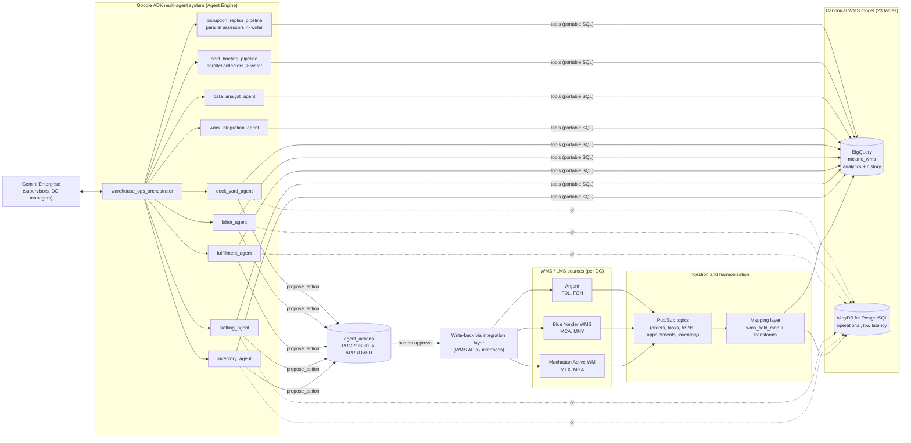

# Architecture and capability design

This document answers sections 1 and 2 of the hackathon brief for use case 3 (Warehouse
Management): architecture and data flow, then a capability-by-capability design with KPIs.
Sections 3 to 5 (demo, roadmap, risks) are in [DEMO_SCRIPT.md](DEMO_SCRIPT.md) and
[ROADMAP.md](ROADMAP.md).

## 1. Architecture and data flow

**Hackathon MVP (what is in this repo)**
- Synthetic WMS data for six DCs is generated and loaded to SQLite (local), BigQuery or AlloyDB.
  The Pub/Sub ingestion and write-back boxes are the pilot design; in the MVP the generator stands in
  for ingestion and approved actions are logged in `agent_actions`.
- One canonical schema ([DATA_MODEL.md](DATA_MODEL.md)) means every tool works for every WMS.
- The agent runs in `adk web` locally, on Vertex AI Agent Engine, or on Cloud Run, and is
  registered in Gemini Enterprise for end users.

**Agent tree**

| Agent | ADK type | Purpose |
|---|---|---|
| `warehouse_ops_orchestrator` | LlmAgent | Front door; routes; approves/rejects actions on explicit user instruction |
| `inventory_agent` | LlmAgent | Positions, FEFO/expiry, replenishment, stockout risk, cycle counts, anomalies, photo damage checks |
| `slotting_agent` | LlmAgent | Velocity vs travel swaps, affinity, ergonomics, space |
| `fulfillment_agent` | LlmAgent | Orders, waves vs cutoff, zone backlog diagnosis, shorts, wave sequencing |
| `labor_agent` | LlmAgent | Performance vs engineered standards, labor gap, rosters |
| `dock_yard_agent` | LlmAgent | Exceptions, arrival prediction, inbound impact, door assignment |
| `wms_integration_agent` | LlmAgent | Cross-WMS landscape, interface health, field mapping, KPI scorecard |
| `data_analyst_agent` | LlmAgent | Guarded read-only SQL for anything else |
| `shift_briefing_pipeline` | SequentialAgent(ParallelAgent x4, writer) | Start-of-shift briefing |
| `disruption_replan_pipeline` | SequentialAgent(ParallelAgent x3, writer) | Mid-shift re-plan (late inbound + labor shortfall) |

The parallel collectors write their findings to session state (`output_key`), and the writer's
instruction provider reads that state, so the writer only sees facts gathered by tools.

**Guardrails**
- Hard constraints in tools, not just prompts: door recommendations filter refrigerated doors for
  cold loads; slotting swaps stay within a temperature zone; replenishment picks the FEFO lot;
  anomaly scan flags cold product in ambient slots and expired product still available.
- Human approval: `propose_action` records the expected gain and the approver role; only
  `decide_action` after explicit approval moves it to APPROVED.
- Read-only SQL guard: single SELECT, known tables only, forbidden keywords, 200-row cap.
- Supervisor answers under 100 words with one next action (prompt rule).

## 2. Capability-by-capability design

### 2.1 Slotting
- **Inputs**: pick tasks (14-day velocity), slot assignments, location travel distance, golden-zone
  flag, case weight, order co-occurrence.
- **Method**: within each temperature zone, rank SKUs by picks and faces by distance; slotting
  efficiency = ideal travel / current travel. Pair top-20% velocity SKUs in far faces with slow SKUs
  in near faces (swap); savings = picks difference x distance difference x 2 (round trip) at 4 ft/s.
  Affinity uses lift over orders; ergonomics flags heavy (35 lb or more) fast movers above floor level.
- **Tools**: `analyze_slotting`, `get_sku_affinity`, `get_slot_utilization`.
- **KPIs**: pick travel ft/week, slotting efficiency %, cases per labor hour, ergonomic flags closed.
- **Approver**: DC operations manager (RESLOT).

### 2.2 Wave and task planning, labor balancing
- **Inputs**: open orders and lines for tomorrow's ship date, waves with cutoff (departure minus 90
  min), pick tasks, engineered standards, schedules with call-outs/PTO, recent performance.
- **Method**: wave progress and projected finish from observed rate; earliest-deadline-first
  sequencing with cumulative minimum crew within the night-shift window; required vs available
  picker hours by zone at the DC's recent performance and 85% utilization; gap-closing options
  (day-shift overtime with cost, cross-trained loaders/forklift drivers, zone moves).
- **Tools**: `get_wave_progress`, `recommend_wave_release`, `forecast_labor_requirement`,
  `get_labor_productivity`, `get_shift_roster`, `diagnose_zone_backlog`.
- **KPIs**: cases (units) per labor hour, performance % to standard, waves completed before cutoff,
  overtime hours, on-time route departures.
- **Approver**: shift supervisor (RELEASE_WAVE, REBALANCE_LABOR); DC manager for overtime.

### 2.3 Dock scheduling
- **Inputs**: dock appointments, doors (refrigerated flag), carrier arrival history, ASN lines,
  tomorrow's open demand and available stock.
- **Method**: exceptions (late > 30 min, waiting > 60 min, detention risk > 120 min, no-show,
  double booking, temperature mismatch); baseline arrival prediction from carrier median lateness
  (Vertex AI forecasting in the pilot); inbound impact ranks open trailers by cases at risk for
  tomorrow's orders; door recommender respects direction, refrigeration and the time window.
- **Tools**: `get_dock_exceptions`, `predict_dock_arrivals`, `assess_inbound_impact`,
  `recommend_door`, `get_dock_schedule`, `get_door_utilization`.
- **KPIs**: dock dwell minutes, detention charges, door utilization %, inbound on-time %, cold-chain
  door violations (target 0).
- **Approver**: dock / yard lead (REASSIGN_DOOR).

### 2.4 Inventory integrity
- **Inputs**: inventory lots, slot min/max, allocations, cycle counts, expiry dates.
- **Method**: rule-based anomaly scan (negative on-hand, over-allocation, expired-but-available,
  over-capacity, temperature-zone violation, stale holds) ranked by severity into a cycle-count
  list; repeat-variance detection; FEFO expiry window; replenishment with FEFO lot selection and
  CRITICAL flag when allocated picks exceed the face; stockout risk vs open demand. Vertex AI anomaly
  detection on transaction streams is the pilot upgrade.
- **Tools**: `detect_inventory_anomalies`, `get_cycle_count_variances`, `get_expiring_inventory`,
  `get_replenishment_needs`, `get_stockout_risk`, `get_inventory_position`.
- **KPIs**: inventory record accuracy %, $ variance, shrink $ from expiry, short picks per 1,000 lines.
- **Approver**: inventory control lead (CYCLE_COUNT, REPLENISH).

### 2.5 Supervisor copilot
- **Inputs**: everything above through the orchestrator.
- **Method**: routing to specialists, `diagnose_zone_backlog` for "why are we behind" questions,
  shift briefing and re-plan pipelines, `lookup_order` for customer questions, guarded SQL for
  the long tail; Gemini multimodal for photos of damaged cases or labels (inventory agent).
- **KPIs**: time to answer, answers with a next action and approver (target 100%), adoption
  (weekly active supervisors), actions approved vs rejected.

### 2.6 Cross-WMS integration view
- **Method**: interface health by platform and interface with spike detection; field mapping
  lookup; KPI scorecard by DC and platform (fill rate, performance, inbound on-time, inventory
  accuracy, integration error rate).
- **KPIs**: interface error rate, mean time to detect a failing interface.

## Deployment
- Local: `make data && adk web .`
- Agent Engine: `bash deploy/deploy_agent_engine.sh` (BigQuery or AlloyDB backend)
- Gemini Enterprise: `bash deploy/register_gemini_enterprise.sh` or the console (Agents > Add agent)
- Cloud Run alternative with the ADK web UI: `make deploy-cloud-run`

See [GEMINI_ENTERPRISE.md](GEMINI_ENTERPRISE.md) for the step-by-step.
