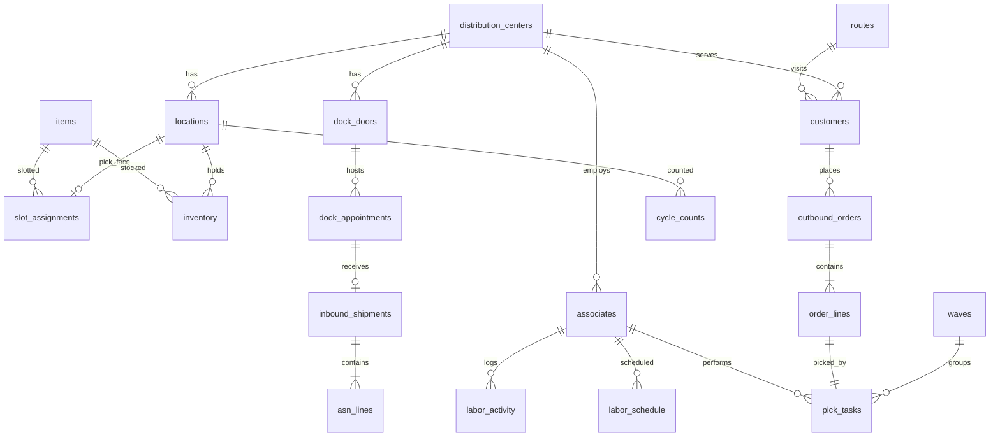

# Data model: canonical WMS schema

Generated from `warehouse_agent/schema.py` (the single source of truth). One schema harmonizes
Manhattan Active WM, Blue Yonder WMS and Argent; `distribution_centers.wms_system` says which
platform owns each DC and `wms_field_map` maps illustrative source field names to canonical fields.
Row counts are for the default synthetic dataset (seed 27, anchor 2026-10-27).

## Network and masters

### `distribution_centers` (6 rows; key: dc_id)

| Column | Type | Description |
|---|---|---|
| `dc_id` | STRING | Distribution center code, e.g. MTX |
| `dc_name` | STRING | Display name |
| `city` | STRING |  |
| `state` | STRING | US state code |
| `segment` | STRING | RETAIL (convenience/grocery) or RESTAURANT (foodservice/QSR) |
| `wms_system` | STRING | MANHATTAN_ACTIVE | BLUE_YONDER | ARGENT |
| `square_feet` | INT |  |
| `timezone` | STRING | IANA timezone |

### `items` (500 rows; key: sku)

| Column | Type | Description |
|---|---|---|
| `sku` | STRING | Canonical item id |
| `description` | STRING |  |
| `category` | STRING | Merchandise category |
| `segment` | STRING | RETAIL | RESTAURANT | BOTH |
| `temp_zone` | STRING | DRY | COOLER | FREEZER |
| `uom` | STRING | Selling unit of measure (CS = case) |
| `case_pack` | INT | Eaches per case |
| `case_cube_ft` | FLOAT | Cubic feet per case |
| `case_weight_lb` | FLOAT |  |
| `unit_cost` | FLOAT | Cost per case, USD |
| `shelf_life_days` | INT | 0 = not date controlled |
| `supplier` | STRING |  |

### `customers` (1,080 rows; key: customer_id)

| Column | Type | Description |
|---|---|---|
| `customer_id` | STRING |  |
| `customer_name` | STRING | Store / restaurant name |
| `chain` | STRING | Banner or brand |
| `segment` | STRING | RETAIL | RESTAURANT |
| `dc_id` | STRING | Servicing DC |
| `route_id` | STRING | Delivery route |
| `city` | STRING |  |
| `state` | STRING |  |

### `routes` (72 rows; key: route_id)

| Column | Type | Description |
|---|---|---|
| `route_id` | STRING |  |
| `dc_id` | STRING |  |
| `departure_time` | STRING | Planned trailer departure HH:MM local |
| `stops` | INT | Customers on the route |
| `trailer_type` | STRING | DRY | MULTI_TEMP |

### `labor_standards` (12 rows; key: role, zone)

| Column | Type | Description |
|---|---|---|
| `role` | STRING |  |
| `zone` | STRING |  |
| `engineered_rate` | FLOAT | Cases per hour at 100% performance |

## Facility and inventory

### `locations` (7,800 rows; key: location_id)

| Column | Type | Description |
|---|---|---|
| `location_id` | STRING | DC-zone-aisle-bay-level |
| `dc_id` | STRING |  |
| `zone` | STRING | DRY | COOLER | FREEZER |
| `aisle` | STRING |  |
| `bay` | INT |  |
| `level` | INT | 1 = floor |
| `location_type` | STRING | PICK | RESERVE |
| `is_golden_zone` | INT | 1 = waist-height pick face near the front of the aisle |
| `capacity_cases` | INT |  |
| `distance_to_dock_ft` | FLOAT | Travel distance from the shipping dock |
| `pick_sequence` | INT | Walk sequence for pick path |

### `slot_assignments` (1,800 rows; key: location_id)

| Column | Type | Description |
|---|---|---|
| `dc_id` | STRING |  |
| `location_id` | STRING | PICK location |
| `sku` | STRING |  |
| `min_qty` | INT | Replenishment trigger, cases |
| `max_qty` | INT | Replenish-up-to, cases |
| `assigned_date` | DATE |  |

### `inventory` (5,016 rows; key: inventory_id)

| Column | Type | Description |
|---|---|---|
| `inventory_id` | STRING |  |
| `dc_id` | STRING |  |
| `location_id` | STRING |  |
| `sku` | STRING |  |
| `lot_number` | STRING |  |
| `qty_on_hand` | INT | Cases |
| `qty_allocated` | INT | Cases allocated to open orders |
| `status` | STRING | AVAILABLE | HOLD | DAMAGED | QC |
| `received_date` | DATE |  |
| `expiry_date` | DATE | NULL when not date controlled |

### `cycle_counts` (573 rows; key: count_id)

| Column | Type | Description |
|---|---|---|
| `count_id` | STRING |  |
| `dc_id` | STRING |  |
| `location_id` | STRING |  |
| `sku` | STRING |  |
| `count_date` | DATE |  |
| `system_qty` | INT |  |
| `counted_qty` | INT |  |
| `variance_qty` | INT | counted - system |
| `variance_value` | FLOAT | USD |
| `counter_id` | STRING |  |

## Inbound and dock

### `inbound_shipments` (432 rows; key: asn_id)

| Column | Type | Description |
|---|---|---|
| `asn_id` | STRING | Advance ship notice |
| `dc_id` | STRING |  |
| `po_number` | STRING |  |
| `supplier` | STRING |  |
| `appointment_id` | STRING |  |
| `expected_date` | DATE |  |
| `temp_zone` | STRING |  |
| `pallets` | INT |  |
| `cases` | INT |  |
| `status` | STRING | SCHEDULED | ARRIVED | RECEIVING | RECEIVED | CANCELLED |

### `asn_lines` (2,390 rows; key: asn_id, line_number)

| Column | Type | Description |
|---|---|---|
| `asn_id` | STRING |  |
| `line_number` | INT |  |
| `dc_id` | STRING |  |
| `sku` | STRING |  |
| `cases_expected` | INT |  |
| `cases_received` | INT |  |

### `dock_doors` (168 rows; key: door_id)

| Column | Type | Description |
|---|---|---|
| `door_id` | STRING |  |
| `dc_id` | STRING |  |
| `door_type` | STRING | INBOUND | OUTBOUND |
| `temp_capable` | INT | 1 = refrigerated seal / reefer plug |

### `dock_appointments` (720 rows; key: appointment_id)

| Column | Type | Description |
|---|---|---|
| `appointment_id` | STRING |  |
| `dc_id` | STRING |  |
| `door_id` | STRING |  |
| `direction` | STRING | INBOUND | OUTBOUND |
| `carrier` | STRING |  |
| `reference_id` | STRING | ASN id (inbound) or route id (outbound) |
| `temp_zone` | STRING | Most restrictive temp zone on the trailer |
| `scheduled_start` | DATETIME |  |
| `scheduled_end` | DATETIME |  |
| `actual_arrival` | DATETIME | NULL = not arrived |
| `door_assigned_at` | DATETIME |  |
| `completed_at` | DATETIME |  |
| `status` | STRING | SCHEDULED | CHECKED_IN | AT_DOOR | COMPLETED | NO_SHOW |

## Outbound

### `outbound_orders` (6,946 rows; key: order_id)

| Column | Type | Description |
|---|---|---|
| `order_id` | STRING |  |
| `dc_id` | STRING |  |
| `customer_id` | STRING |  |
| `route_id` | STRING |  |
| `order_date` | DATE |  |
| `ship_date` | DATE |  |
| `wave_id` | STRING | NULL until waved |
| `status` | STRING | NEW | RELEASED | PICKING | PICKED | LOADED | SHIPPED | CANCELLED |
| `priority` | INT | 1 = highest |
| `total_lines` | INT |  |
| `total_cases` | INT |  |

### `order_lines` (102,690 rows; key: order_id, line_number)

| Column | Type | Description |
|---|---|---|
| `order_id` | STRING |  |
| `line_number` | INT |  |
| `dc_id` | STRING |  |
| `sku` | STRING |  |
| `qty_ordered` | INT | Cases |
| `qty_picked` | INT | Cases |
| `qty_short` | INT | Cases |
| `short_reason` | STRING | NULL | NO_STOCK | STOCK_ON_HOLD | PICK_FACE_EMPTY | DAMAGED |

### `waves` (360 rows; key: wave_id)

| Column | Type | Description |
|---|---|---|
| `wave_id` | STRING |  |
| `dc_id` | STRING |  |
| `ship_date` | DATE |  |
| `wave_type` | STRING | ROUTE | TEMP_ZONE | RUSH |
| `temp_zone` | STRING |  |
| `released_at` | DATETIME |  |
| `cutoff_at` | DATETIME | Pick must finish by (trailer departure - load time) |
| `status` | STRING | PLANNED | RELEASED | IN_PROGRESS | COMPLETE |
| `order_count` | INT |  |
| `line_count` | INT |  |

### `pick_tasks` (102,690 rows; key: task_id)

| Column | Type | Description |
|---|---|---|
| `task_id` | STRING |  |
| `dc_id` | STRING |  |
| `wave_id` | STRING |  |
| `order_id` | STRING |  |
| `line_number` | INT |  |
| `sku` | STRING |  |
| `location_id` | STRING |  |
| `qty` | INT | Cases to pick |
| `qty_picked` | INT |  |
| `associate_id` | STRING |  |
| `status` | STRING | OPEN | ASSIGNED | IN_PROGRESS | COMPLETE | SHORT |
| `created_at` | DATETIME |  |
| `completed_at` | DATETIME |  |
| `travel_ft` | FLOAT | Round-trip travel for this task |

## Labor

### `associates` (156 rows; key: associate_id)

| Column | Type | Description |
|---|---|---|
| `associate_id` | STRING |  |
| `dc_id` | STRING |  |
| `associate_name` | STRING |  |
| `role` | STRING | PICKER | LOADER | RECEIVER | FORKLIFT |
| `home_zone` | STRING | DRY | COOLER | FREEZER |
| `shift` | STRING | DAY | NIGHT |
| `hire_date` | DATE |  |
| `hourly_rate` | FLOAT | USD |

### `labor_activity` (2,003 rows; key: activity_id)

| Column | Type | Description |
|---|---|---|
| `activity_id` | STRING |  |
| `dc_id` | STRING |  |
| `associate_id` | STRING |  |
| `work_date` | DATE |  |
| `role` | STRING |  |
| `zone` | STRING |  |
| `cases_handled` | INT |  |
| `direct_hours` | FLOAT |  |
| `indirect_hours` | FLOAT | Meetings, travel to zone, equipment issues |

### `labor_schedule` (312 rows; key: associate_id, work_date)

| Column | Type | Description |
|---|---|---|
| `dc_id` | STRING |  |
| `associate_id` | STRING |  |
| `work_date` | DATE |  |
| `shift` | STRING |  |
| `scheduled_hours` | FLOAT |  |
| `status` | STRING | SCHEDULED | PTO | CALLOUT |

## Integration and governance

### `wms_integration_events` (2,962 rows; key: event_id)

| Column | Type | Description |
|---|---|---|
| `event_id` | STRING |  |
| `dc_id` | STRING |  |
| `source_system` | STRING | MANHATTAN_ACTIVE | BLUE_YONDER | ARGENT |
| `interface` | STRING | Canonical interface, e.g. ITEM_MASTER, ASN, ORDER_RELEASE, SHIP_CONFIRM |
| `source_message_type` | STRING | Source-native message name (illustrative) |
| `event_time` | DATETIME |  |
| `status` | STRING | SUCCESS | ERROR | RETRY |
| `error_code` | STRING |  |
| `error_detail` | STRING |  |
| `reference_id` | STRING | Order, ASN or SKU the message is about |

### `wms_field_map` (31 rows; key: )

| Column | Type | Description |
|---|---|---|
| `source_system` | STRING |  |
| `source_entity` | STRING |  |
| `source_field` | STRING | Illustrative source-native name |
| `canonical_table` | STRING |  |
| `canonical_field` | STRING |  |
| `transform_rule` | STRING |  |

### `agent_actions` (1 rows; key: action_id)

| Column | Type | Description |
|---|---|---|
| `action_id` | STRING |  |
| `created_at` | DATETIME |  |
| `dc_id` | STRING |  |
| `action_type` | STRING | REPLENISH | RESLOT | REASSIGN_DOOR | RELEASE_WAVE | REBALANCE_LABOR | CYCLE_COUNT | OTHER |
| `details` | STRING | JSON payload |
| `rationale` | STRING |  |
| `status` | STRING | PROPOSED | APPROVED | REJECTED |
| `decided_at` | DATETIME |  |
